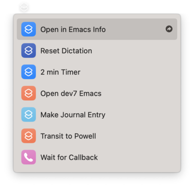

* Counterpart - Open Texinfo Web Page in Emacs Info

*Counterpart* is a macOS utility to open the counterpart of a [[https://www.gnu.org/software/texinfo/manual/texinfo/html_node/index.html][Texinfo]] web page in [[https://www.gnu.org/software/emacs/manual/html_node/info/index.html][GNU Emacs Info]].

*Counterpart* requires usage of the Safari web browser and installation of an [[https://support.apple.com/en-gb/guide/shortcuts-mac/apdf22b0444c/mac][iCloud Shortcut]].

*Counterpart* only works on Texinfo HTML generated with one page per node.

* Requirements

- macOS 15.7 (Sequoia) +
- [[https://www.gnu.org/software/emacs/][GNU Emacs]] 30.1+
- Safari 26+
- Python 3+

While not strictly required, no configuration is required if Scrim is installed.

- [[http://yummymelon.com/scrim/][Scrim]] v1.0+

* Install

Install the iCloud Shortcut by clicking the link below:

- [[https://www.icloud.com/shortcuts/dee5783c765443dd8c231b2cc44f8e94][Open in Emacs Info Shortcut]]

If you have Scrim installed, you are ready to go.

Alternately you can edit the Shortcut to use ~emacsclient~. This requires you to set the following variables in the Python script accordingly:

#+begin_src python
  use_scrim = False
  # Set to your local configuration if use_scrim = False
  emacsclient_path = "<path to emacsclient>"
#+end_src

* Usage

1. From Safari, open a web page generated via Texinfo HTML export.
   
2. From the main menu bar, click on the Shortcuts icon and choose the menu item "Open in Emacs Info".
   

3. The counterpart Info node of the web page should be displayed in Emacs Info.

* Known Issues

- Heuristic method used to map Texinfo web page URL back to Info node. There are likely websites hosting Texinfo documentation where this method does not work.

- Intermittent failure to map the top-level Texinfo web page back to the Top Info node.
  
  
* Sponsorship

If you enjoy using *Counterpart*, please consider buying me a coffee to help support its development and maintenance.

[[https://www.buymeacoffee.com/kickingvegas][http://yummymelon.com/devnull/theme/images/icons/buymecoffee.png]]

Please star and share this project to others as well. Thank you!

* Acknowledgments

Thanks to all the contributors to the Apple and GNU ecosystems from which *Counterpart* builds from. This work would not be possible without your efforts.

# Local Variables:
# burnish-backend: html
# End:
