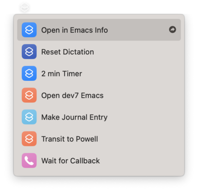

#+startup: overview nologdone
#+startup: showeverything
#+TITLE: Counterpart User Guide
#+SUBTITLE: for version {{{version}}}
#+AUTHOR: Charles Y. Choi
#+EMAIL: kickingvegas@gmail.com
#+OPTIONS: ':t toc:t author:t email:t H:4 f:t
#+LANGUAGE: en
#+MACRO: version 0.0.1-rc.3
#+MACRO: kbd (eval (org-texinfo-kbd-macro $1))
#+TEXINFO_FILENAME: counterpart.info
#+TEXINFO_CLASS: casual
#+TEXINFO_HEADER: @syncodeindex pg cp
#+TEXINFO_HEADER: @paragraphindent none
#+TEXINFO_TITLEPAGE: t
#+TEXINFO_DIR_CATEGORY: Emacs misc features
#+TEXINFO_DIR_NAME: Counterpart
#+TEXINFO_DIR_DESC: Counterpart is a macOS utility to open the counterpart of a Texinfo web page in GNU Emacs Info.
#+TEXINFO_PRINTED_TITLE: Counterpart User Guide

Version: {{{version}}}

#+TEXINFO: Copyright © 2026 @w{Charles Y. Choi}

THIS PROJECT IS WIP.

*Counterpart* is a macOS utility to open the counterpart of a Texinfo ([[info:texinfo#Top]]) web page in GNU Emacs Info ([[info:info#Top]]).

*Counterpart* requires usage of the Safari web browser and installation of an iCloud Shortcut.

*Counterpart* only works on Texinfo HTML generated with one page per node.

#+INCLUDE: "./sponsorship.org"

* Copying
:PROPERTIES:
:COPYING: t
:END:

Copyright © 2026 Charles Y. Choi

* Requirements
:PROPERTIES:
:CUSTOM_ID: requirements
:END:
#+CINDEX: Requirements

- macOS 15.7 (Sequoia) +
- GNU Emacs 30.1+
- Safari 26+
- Python 3+

While not strictly required, no configuration is required if Scrim is installed.

- [[http://yummymelon.com/scrim/][Scrim]] v1.0+

* Install
:PROPERTIES:
:CUSTOM_ID: install
:END:
#+CINDEX: Install

Install the iCloud Shortcut by clicking the link below:

- [[https://www.icloud.com/shortcuts/dee5783c765443dd8c231b2cc44f8e94][Open in Emacs Info Shortcut]]

If you have [[http://yummymelon.com/scrim/][Scrim]] installed, you are ready to go.

Alternately you can edit the Shortcut to use ~emacsclient~. This requires you to set the following variables in the Python script accordingly:

#+begin_src python
  use_scrim = False
  # Set to your local configuration if use_scrim = False
  emacsclient_path = "<path to emacsclient>"
#+end_src

* Usage
:PROPERTIES:
:CUSTOM_ID: install
:END:

1. From Safari, open a web page generated via Texinfo HTML export.

2. From the main menu bar, click on the Shortcuts icon and choose the menu item "Open in Emacs Info".

   

3. The counterpart Info node of the web page should be displayed in Emacs Info.

* Feedback & Discussion
#+CINDEX: Feedback
Please report any feedback about *counterpart* to the [[https://github.com/kickingvegas/counterpart/issues][issue tracker on GitHub]].

#+CINDEX: Discussion
To participate in general discussion about using *counterpart*, please join the [[https://github.com/kickingvegas/counterpart/discussions][discussion group]].

* Sponsorship
#+CINDEX: Sponsorship

#+INCLUDE: "./sponsorship.org"

* About
#+CINDEX: About

[[https://github.com/kickingvegas/counterpart][Counterpart]] was conceived and crafted by Charles Y. Choi in San Francisco, California.

Thank you for using *counterpart*.

Always choose love.

* Acknowledgments
#+CINDEX: Acknowledgments

Thanks to all the contributors to the Apple and GNU ecosystems from which *Counterpart* builds from. This work would not be possible without your efforts.

* Main Index
:PROPERTIES:
:INDEX:    cp
:END:

Index for this user guide.

# Local Variables:
# burnish-backend: kvtexinfo
# End:
